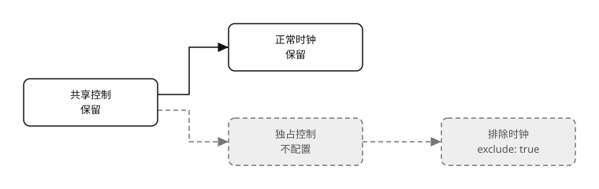

# 时钟初始化

## 排除时钟

`exclude: true` 的时钟不参与求解，也不写寄存器。只供它使用的上游 div、mux、gate 一起排除，配置的初始值不会让这些节点重新参与初始化。

共享控制仍被正常时钟使用时保留。只属于被排除时钟的后续控制不保留，两个节点使用同一个寄存器地址也不会改变这个判断。

## 初始化范围

原本独立配置的节点继续初始化。保留的 mux 仍初始化所有输入分支，不按当前选择裁剪；gate 固定打开。

无频率要求、无寄存器动作的 cell 等末端节点不形成需求。删除目标时钟后只剩这类节点时，空载上游会被移除。带寄存器的独立 gate 有开启动作；普通无需求节点的删除不会取消该动作，但显式 exclude 的独占上游仍要排除。

## 固定分频与来源

可编程分频使用 `init_ratio` 指定初始分频比，同时填写 `regs`。可编程 mux 使用 `init_sel` 指定输入编号，同时填写 `reg`。没有指定时，求解器选择合法值；两个来源频率相同，不代表它们可以互换。

`ratio` 和 `sel` 只描述固定分频和固定输入选择，不写对应寄存器；分别不能与 `init_ratio`、`init_sel` 同时填写。

## 普通寄存器

同一寄存器的保留字段合成一个数组项，只写一次。写入值从零组合，未参与配置的字段为零；共享寄存器不能成为保留已排除节点的理由。

`extra_regs` 中的同地址字段合入普通数组项，相同字段以 `extra_regs` 为准。只有附加字段的寄存器放在数组前面。PLL 的多阶段写入和等待锁定不按普通数组规则合并。

## 排除示例

`example/exclusion.yaml` 保留 12 MHz 正常时钟，排除另一条时钟及其独占 div、mux、gate。独立 gate 与被排除 gate 共用地址 `0xd00`，只留下独立 gate 的 bit 1。

| 地址 | 写入值 | 含义 |
| --- | --- | --- |
| `0xd10` | `0x1` | 仅有附加字段，排在数组最前 |
| `0x520` | `0x103` | 正常分频比为 2，解除复位并加载 |
| `0x60c` | `0x1` | 正常 gate 打开 |
| `0xd00` | `0x2` | 独立 gate 的 bit 1 为 1，被排除 gate 的 bit 0 为 0 |
| `0x514` | `0x0` | 正常 mux 选择输入 0 |

独占 div 和 mux 的地址 `0x500`、`0x504` 不出现。给另一个正常时钟引用该 div 后，会保留共享 div；后续独占 mux 和 gate 仍不配置。

## 保留必须目标

必须初始化的目标不能填写 `exclude: true`。恢复目标时逐项取消排除，不修改分频公式来补偿目标缺失。即使寄存器写入值没有变化，也要检查必须目标是否仍参与求解。
