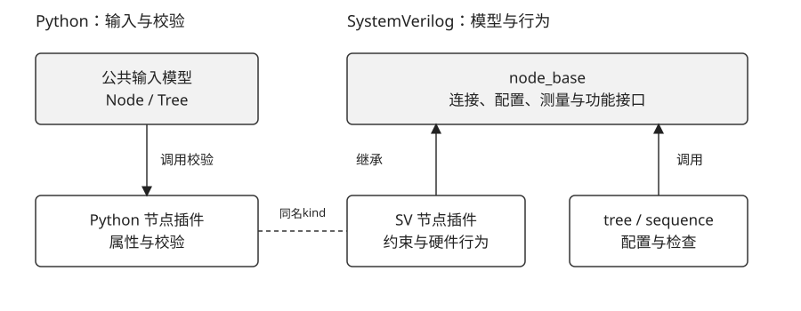

# 结构

一个设计节点由两个插件文件定义：Python 文件接收属性，SV 文件实现约束和硬件行为。tree、配置调度和检查只调用基础接口，不按 `kind` 分支。



Python 的注册表和 SV 的 filelist 是两份显式清单。新增节点时各登记一次，不扫描目录自动加载。未知 kind 仍生成对应的 SV 类型；缺少类定义时由 SV 编译报错。

## 输入到实例

1. Python 公共模型读取节点名、连接、端口和寄存器路径。
2. 对应插件校验其余属性；输出组覆盖与节点属性合并后再校验。
3. 模板为每个输出组生成一个 SV 对象，设置 source、同器件输出和控制字段。
4. `tree.build()` 绑定寄存器，调用初始化钩子并随机化。

`exclude: true` 的节点不生成对象、接口或寄存器绑定；其他节点对它的引用不再连接。排除是修改验证模型，不代表关闭 RTL 中的时钟。

## 三类代码

**基础代码**保留连接、寄存器访问、配置动作和测量服务。它只知道 node_base，不知道 mux、gate 或分频器的编码。

**节点插件**定义频率和活动约束、寄存器编码、临时运行需求及功能检查。插件可以继承共享能力类，例如分频、极性和 PLL 基类。

**sequence**决定检查哪些对象、何时检查、怎样汇总结果。需要驱动或采样时，通过 operation 提供的测试服务执行，test 包装不直接访问 RTL 或寄存器。

## 配置与检查

配置从 `tree.configure()` 进入：随机化目标，收集节点动作，检查依赖，执行寄存器访问和完成等待。`config_reg(tree)` 与 sequencer 的同名 task 只是调用它，不维护另一份配置代码。

测量读取求解结果。flip 使用插件定义的独立激励和预期。route 使用 source 连接及端口接口。它们共享节点对象，但检查对象和副作用不同。

## 目录

```text
node/
  python/         输入模型、插件属性和显式注册表
  base/           节点、tree、寄存器服务和配置调度
  plugin/         SV节点实现
    support/      多个节点共用的能力
model/            运行时模型说明
component/        agent与kit_sequencer
sequence/         检查编排及operation
top/              信号接口、路径宏和驱动逻辑
core/             频率计算公式
```

纯配置使用相同节点和调度，只是不加载测试服务、interface、component 和 sequence。插件中的接口相关声明受编译宏保护。
