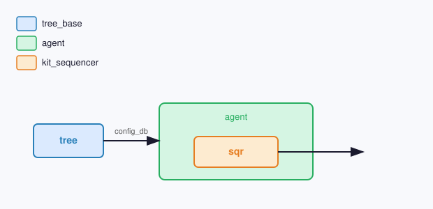

# UVM 组件

## config_db

| 键 | 类型 | 说明 |
| --- | --- | --- |
| `tree` | **tree_base** | 时钟树句柄 |

## 快捷函数

### config_reg

按树节点写寄存器。

| 参数 | 类型 | 默认值 | 说明 |
| --- | --- | --- | --- |
| **tree** | **tree_base** | 空 | 默认空则用 **sqr.tree** |

### check_measure

校验频率与占空比；一次 **start_measure** 并行观测。先确认有活动，再计数稳定周期。

| 参数 | 类型 | 默认值 | 说明 |
| --- | --- | --- | --- |
| **tree** | **tree_base** | 空 | 默认空则用 **sqr.tree** |
| **check_observation** | **bit** | `1` | 为真时检查所有可观测节点 |
| **check_freq** | **bit** | `1` | 为真时检查可观测节点频率 |
| **check_duty** | **bit** | `1` | 为真时检查声明占空比能力的节点 |
| **debug** | **bit** | `0` | 为真时 **check_measure** 打印等待进度 |

### test_measure

写寄存器后校验频率与占空比；一次 **check_measure** 并行观测。

| 参数 | 类型 | 默认值 | 说明 |
| --- | --- | --- | --- |
| **tree** | **tree_base** | 空 | 默认空则用 **sqr.tree** |
| **check_observation** | **bit** | `1` | 为真时检查所有可观测节点 |
| **check_freq** | **bit** | `1` | 为真时检查可观测节点频率 |
| **check_duty** | **bit** | `1` | 为真时检查声明占空比能力的节点 |
| **debug** | **bit** | `0` | 为真时 **check_measure** 打印等待进度 |

### test_flip

在节点自身端口施加独立激励，检查声明功能契约的节点。

| 参数 | 类型 | 默认值 | 说明 |
| --- | --- | --- | --- |
| **tree** | **tree_base** | 空 | 默认空则用 **sqr.tree** |
| **debug** | **bit** | `0` | 为真时打印测试开始信息 |

### test_route

驱动前级输出并采样后级输入，检查 RTL 连线。只有拓扑边两端均已连接接口时才检查；个别边跳过，没有连线可检查时报错。

| 参数 | 类型 | 默认值 | 说明 |
| --- | --- | --- | --- |
| **tree** | **tree_base** | 空 | 时钟树句柄；默认空则用 **sqr.tree** |
| **debug** | **bit** | `0` | 为真时打印测试开始信息 |
