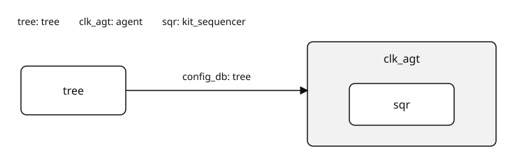

# UVM 组件

agent 包含 kit_sequencer 实例 `sqr`；通过 `sqr` 调用配置和检查 task。

agent 在 build_phase 取得 tree，并赋给 `sqr.tree`。图中省略类型名前缀。

## config_db

| 键 | 类型 | 说明 |
| --- | --- | --- |
| `tree` | **tree** | 时钟树句柄，类型名前缀与 agent 一致 |

## 快捷函数

### config_reg

按树节点写寄存器。

| 参数 | 类型 | 默认值 | 说明 |
| --- | --- | --- | --- |
| **tree** | **tree_base** | 空 | 默认空则用 **sqr.tree** |

### check_measure

检查活动、频率与占空比。

| 参数 | 类型 | 默认值 | 说明 |
| --- | --- | --- | --- |
| **tree** | **tree_base** | 空 | 默认空则用 **sqr.tree** |
| **check_observation** | **bit** | `1` | 启用节点测量；置 0 会终止检查 |
| **check_freq** | **bit** | `1` | 检查频率；置 0 仍检查活动 |
| **check_duty** | **bit** | `1` | 为真时检查声明占空比能力的节点 |

### test_measure

配置寄存器后检查活动、频率与占空比。

| 参数 | 类型 | 默认值 | 说明 |
| --- | --- | --- | --- |
| **tree** | **tree_base** | 空 | 默认空则用 **sqr.tree** |
| **check_observation** | **bit** | `1` | 启用节点测量；置 0 会终止检查 |
| **check_freq** | **bit** | `1` | 检查频率；置 0 仍检查活动 |
| **check_duty** | **bit** | `1` | 为真时检查声明占空比能力的节点 |

### test_flip

检查节点插件提供的寄存器功能。

| 参数 | 类型 | 默认值 | 说明 |
| --- | --- | --- | --- |
| **tree** | **tree_base** | 空 | 默认空则用 **sqr.tree** |

### test_route

检查器件之间的 RTL 连线。

| 参数 | 类型 | 默认值 | 说明 |
| --- | --- | --- | --- |
| **tree** | **tree_base** | 空 | 时钟树句柄；默认空则用 **sqr.tree** |

## 日志

`UVM_LOW` 显示配置、测试点、跳过与汇总，`UVM_HIGH` 显示读回跳过和逐项测量结果，`UVM_DEBUG` 显示等待进度和接口状态。错误不受 INFO verbosity 过滤。
