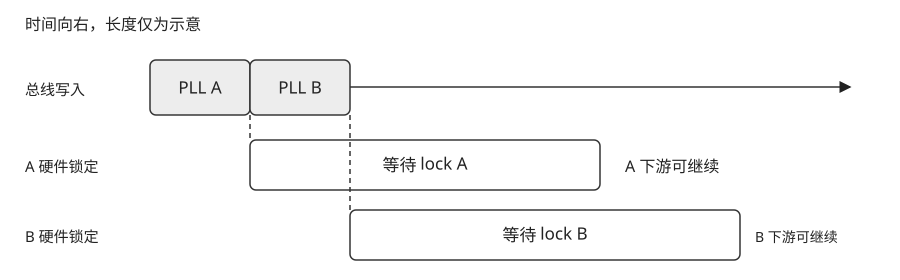

# 配置计划

无毛刺 mux 切换需要旧、新输入同时运行；其他节点可能已经请求关闭旧输入。配置不能按节点顺序逐个写完，而要把“提供时钟直到切换完成”表达为临时需求。

## mux 切换

1. 读取旧sel，与目标相同则省略切换。
2. 创建select动作，请求旧、新输入保持可用，直到切换完成。
3. 两个输入就绪后，等待一个最慢输入周期，再写sel。
4. 等待 `switch_cycles` 个最慢输入周期，期间执行其他就绪动作。
5. 切换完成后释放输入需求；旧输入没有其他使用者时才允许关闭。

输入频率由源和实际寄存器编码计算，不使用已关闭gate的零频率，也不使用约束容差内随机出的频率。等待周期应覆盖IP同步延迟；没有完成状态时，这只是时间预算，不是锁存完成的读回确认。

## 动作与临时使用

`config_action` 保存owner、插件内部token和前置动作。token 0表示最终配置；其他值由插件自己解释。`config_context` 保存动作、依赖、读回和运行状态，并由一个执行器执行。

`config_lease` 保存同一资源的一次临时使用：提供者、ready动作、release动作和插件快照。相同availability_key的使用合并；release等待所有消费者完成，不靠线程退出顺序计数。

```systemverilog
lease = context_h.require_available(provider, completion);
context_h.after_action(use_action, lease.ready);
```

第一行只声明需求，不立即打开时钟，也不自动让use_action等待ready。第二行不能省略。资源的release会自动等待completion。

mux将写sel和切换完成拆成两个动作；target原本就是该节点的最终动作，select_action由插件添加：

```systemverilog
select_action = context_h.add_action(this, 1, {get_name(), ".select"});
old_input = context_h.require_available(to_source[current_sel], target);
new_input = context_h.require_available(to_source[_resolved_sel], target);
context_h.after_action(select_action, old_input.ready);
context_h.after_action(select_action, new_input.ready);
context_h.after_action(target, select_action);
context_h.defer_action(target);
```

| 动作 | 等待谁 | 完成意味着什么 |
| --- | --- | --- |
| old_input.ready、new_input.ready | 各自的上游需求和必要配置 | 旧、新输入可以使用 |
| select_action | 两个ready | 已写sel，并记录切换完成时刻 |
| target | select_action及完成等待 | 最慢输入的switch_cycles已过 |
| 两个release_action | target及同资源其他消费者 | 不再为本次切换保留输入 |

这里的completion传target，不能传select_action：寄存器写完不等于内部切换完成。示例省略失败分支；实际插件在每次require_available后检查规划结果。

最终目标仍能提供资源时，目标动作排在ready之前；最终目标会关闭资源时，排在release之后。释放不等于关闭：没有最终目标才恢复临时快照；已有开启目标则保持开启。

## 一次配置

1. `tree.configure()` 检查build状态并随机化目标。
2. 收集参与配置的节点，为它们创建最终动作。
3. 插件读取规划需要的硬件状态，添加动作和临时需求。
4. 检查共享编码与全部依赖。循环依赖在写寄存器之前报错。
5. 执行就绪动作；动作完成后才放行后继。

临时状态存放在上下文或lease，不改 `_resolved_*`，不为中间状态重新随机化。不同配置调用使用不同上下文。

## 等待不占住总线

PLL编程在寄存器总线上依次完成，硬件锁定可以重叠。每个PLL确认就绪后放行自己的下游，不等待无关PLL。



长等待拆成启动动作与deferred完成动作。调度器执行当前全部普通动作，再检查到期的poll；没有可运行工作时，才等待最近的下次检查时刻。poll只检查一次，返回complete和正数retry_ns，不能在内部再写长轮询。

锁观察预算从首次实际poll开始，后续不续期。每次都真实读锁状态，包括已到期的最后一次；未知值与超时分别报错。预算默认100us，可通过插件设置修改；它不证明硬件从编程起100us内锁定。总线读取耗时和最后一次调度可能延后返回。

级联PLL仍要等待参考输入。配置值匹配而省略写入时，也需要确认lock。没有绑定锁字段的插件不执行锁等待。

## 共享寄存器

寄存器修改使用前门读回值，不依赖未同步镜像。写回只覆盖绑定切片；同一父寄存器的批量操作合并为一次读写，值未变时省略写入。

共享控制资源的最终目标必须给出一致编码。Python生成编码约束，插件校验实际配置，上下文安排使用与修改的先后；不能用最后一次写入覆盖冲突目标。

## 时间与错误

`time_domain` 独立编译为1fs/1fs。调用 `delay_ns(value)`、`after_ns(value)` 传普通纳秒数值，不传已经在外部时间域换算的 `1ns` 字面量。期限使用64位fs整数，正等待向上量化；范围约5.12小时，越界报错。

该package不改变其他模块的局部单位，但参与全局最小精度，可能影响 `#1step`。它不能恢复外部已经舍入的信号边沿。

规划失败不执行寄存器动作。执行失败不承诺硬件回滚，也不继续释放尚未确认可释放的资源。不能为超时而杀掉正在前门访问的线程；单次访问超时由寄存器服务处理。
