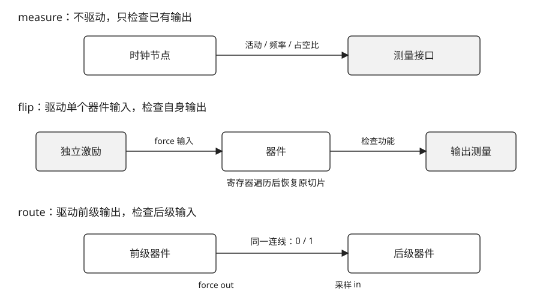

# 检查

检查分为被动测量、器件功能和器件间连线。后两者会驱动 RTL，不能代替测量当前设计状态。

## 选择检查

- **已有配置需要检查**：调用 [check_measure](operation/check_measure/README.md)，不重新写寄存器。
- **设置了新目标**：调用 [test_measure](test/test_measure/README.md)，配置成功后再测量。
- **控制字段与器件行为需要验证**：调用 [test_flip](test/test_flip/README.md)。
- **RTL连接需要验证**：调用 [test_route](test/test_route/README.md)。

flip 和 route 以低功耗配置后的状态为起点。flip 恢复的是各节点测试前的控制切片，不是调用整个测试前的时钟树状态。route 结束时释放驱动，不恢复初始全树配置。

## 直接调用 operation

快捷 task 适合不需要读取详细结果的检查。需要失败节点、跳过队列或自定义测量下限时，创建 req 和 operation，启动后读取 rsp。

test 只编排配置与 operation。operation 选择对象、提供寄存器与接口服务、汇总结果；节点插件定义自身行为。`base_seq` 提供统一 REQ/RSP 基类，不执行检查。

## 结果

| operation | 失败计数 | 没有实际检查 |
| --- | --- | --- |
| [check_measure](operation/check_measure/README.md) | 失败节点队列，节点去重 | 筛选后为空时报错 |
| [flip_check](operation/flip_check/README.md) | 失败检查次数 | 无功能节点时报错；显式屏蔽、stable保护或插件缺接口跳过不等于失败，要同时看tested和skipped |
| [route_check](operation/route_check/README.md) | 失败比较次数 | 无连接或全部跳过时报错 |

`ok` 表示已执行项目通过，不代表没有跳过，也不代表覆盖了未连接的接口。
