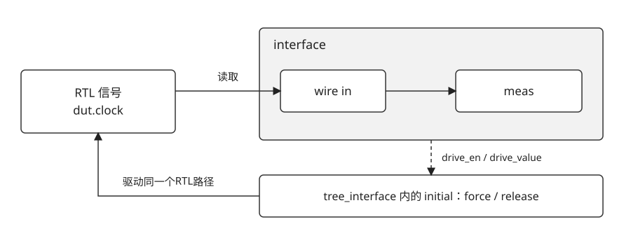

# 信号接口

每个填写了路径的端口都有一个interface实例。tree_interface把这些实例包在一起；connect把句柄分配给节点。读取RTL和驱动RTL使用同一个接口，但方向不同。



## 路径

```yaml
nodes:
  mux_cpu:
    kind: mux
    source: {"0": osc, "1": pll_cpu}
    reg: clk_ctrl.cpu_sel
    in_paths:
      "0": dut.mux_cpu.ref_clk
      "1": dut.mux_cpu.pll_clk
    out_path: dut.mux_cpu.clk_out
  clk_cpu:
    kind: clk
    source: mux_cpu
    path: dut.clk_cpu
```

path用于测量点；in_path、out_path用于默认端口，in_paths、out_paths用于具名端口。路径描述实际RTL，不代替source连接。

## 例化与绑定

```systemverilog
// 放在顶层module中
clk_tree_tree_interface clk_tree_if();

// tree创建和build之后，在环境build_phase中
clk_tree_connect(your_top.clk_tree_if, tree);
```

两个片段分别放在module和UVM环境，不能写在同一作用域。参数顺序为interface在前、tree在后。

### 路径覆盖

生成的path_macros.sv对每条路径使用ifndef。可在它编译前定义同名宏；例如example中的晶振输出：

```systemverilog
`define CLK_TREE_PATH_XTAL_OUT_DEFAULT tb.dut.xtal_clk
```

名字由类名前缀、节点、端口方向和端口键组成。使用生成文件中的实际名字；多输出组也参与命名。

`CLK_TREE__PATH_DISABLE_XTAL_OUT_DEFAULT`会移除该端口接口及其绑定，不移除节点或source。要从模型排除整个节点，使用exclude；只暂停某个节点检查，使用_should_check。

## 驱动

| task | 作用 |
| --- | --- |
| `drive_static(value)` | 持续驱动0或1 |
| `start_clock(freq_hz)` | 产生指定频率，非正值不改变驱动 |
| `release_drive()`、`stop_clock()` | 停止驱动并释放RTL |

interface只有输入wire in，没有输出端口。驱动控制交给tree_interface中紧邻实例的initial块，由它执行force/release，不使用uvm_hdl_force。

半周期等待返回后会重新检查驱动状态；期间改成静态驱动或释放时，旧时钟分支不再翻转。驱动持续到显式释放，可继续的错误路径也要释放。

## 测量

```systemverilog
bit ok;

vif.configure_measurement(15000, 1, 0.0);
vif.start_measure(1, 0);
vif.wait_measure_stable(1, 0, ok);
vif.stop_measure();
```

在task中使用已连接的vif。参数依次为最低频率、平均周期数和最大上升沿间隔ns；间隔0按最低频率推算。示例只等待频率，不等待占空比。开始和等待使用相同检查项。

测量先确认活动，再等待所需项目稳定。只检查活动时，两个need参数都为0。stop_measure保存last_*，并清除当前状态；last_valid只说明保存了活动读数，不证明稳定或误差通过。

活动预算覆盖ACTIVE_CYCLES个最大上升沿间隔。频率按完整窗口计时，一个窗口建立基准，再累计STABLE_CYCLES次稳定比较；占空比按单周期检查。measurement_timeout_ticks返回完整预算，单位fs，外部检查直接使用它。

两个接口均使用1ns/1fs，采样先用整数fs时间戳求跨度，再换算频率。截止检查包含时间精度余量并避开最后一个边沿的同时间槽竞争；最低频率只确定预算，不丢弃已采到的正周期。
